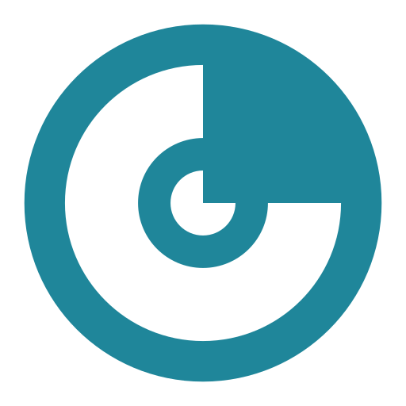

<picture>
  <source media="(prefers-color-scheme: dark)" srcset="./assets/nemukai-mark-kai500.svg">
  <source media="(prefers-color-scheme: light)" srcset="./assets/nemukai-mark-ink900.svg">
  
</picture>

# Hi, I'm $\color{#D17B2E}{\textsf{Nik}}$

Building calm, useful software under <a href="https://nemukai.com"><b>Nemukai</b></a> · Crew planning and optimization at <b>IndiGo</b>

 

 

I run [**Nemukai**](https://nemukai.com), a small studio for products that feel quiet and well made: Indic speech AI, collector tools and open aviation data. By day I write RAVE rules and build planning, optimization and analytics systems for IndiGo's crew operations.

CSE + ML at DTU, class of '25.

 

## Shipping

<table>
  <tr>
    <td width="50%" valign="top">
      <h3><a href="https://logatra.com">Logatra</a></h3>
      

      
Transcription for Hindi, Hinglish and 20+ Indian languages. Turns sales calls, support calls and meetings into transcripts with speaker names, a summary and answers to your questions. Billed in rupees over UPI.

      
Next.js · Sarvam Saaras v4 · Postgres · R2 · Razorpay

    </td>
    <td width="50%" valign="top">
      <h3><a href="https://holohut.in">HoloHut</a></h3>
      

      
Pokémon TCG stock and price radar for India. Scrapes Indian storefronts every hour, folds messy listings into canonical products and keeps a full price and stock history.

      
Next.js 16 · Drizzle · Postgres · R2 · scraper workers

    </td>
  </tr>
  <tr>
    <td width="50%" valign="top">
      <h3><a href="https://vtaircrafts.in">VT Aircrafts</a></h3>
      
 

      
India's commercial fleet index. Every aircraft on DGCA's scheduled and non-scheduled operator permits, rebuilt monthly from the regulator's own PDFs. Data under CC BY 4.0. <a href="https://github.com/Nik-code/vtaircrafts">Repo</a>

      
Python · PDF parsing · Next.js

    </td>
    <td width="50%" valign="top">
      <h3><a href="https://nemukai.com/labs">Logatra Benchmark</a></h3>
      
 

      
Which speech-to-text engine should you actually run for Indian speech? Seven systems scored on ~1,000 minutes of Indic audio plus a fresh held-out split, with accuracy and price side by side. <a href="https://github.com/Nemukai/logatra-benchmark">Repo</a>

      
Python · WER · reproducible offline

    </td>
  </tr>
</table>

 

## Open source

| Project | What it does |
|---|---|
| [obsidian-nemukai](https://github.com/Nik-code/obsidian-nemukai) | Warm, layered Obsidian CSS snippets: movie dashboard, wishlist gallery, custom callouts |
| [roadgraph-svg](https://github.com/Nik-code/roadgraph-svg) | Clean, scriptable SVG road maps from a coordinate and radius, using OpenStreetMap data |
| [memoryweave](https://github.com/Nik-code/memoryweave) | Turns exported AI chats into searchable memories, structured notes and local embeddings |

 

## Research

**Graph-MoE: A Graph-Based LLM Framework for Scalable and Efficient Code Completion.** 6th International Conference for Emerging Technology (INCET), 2025. [IEEE Xplore](https://ieeexplore.ieee.org/document/11139956)

 

## Toolkit

<table>
  <tr><td><b>Languages</b></td><td>TypeScript · Python · SQL · Swift · Bash</td></tr>
  <tr><td><b>AI / ML</b></td><td>PyTorch · speech-to-text eval · RAG · embeddings · Polars</td></tr>
  <tr><td><b>Web</b></td><td>Next.js · React · Tailwind · Drizzle · better-auth · Three.js</td></tr>
  <tr><td><b>Infra</b></td><td>Hetzner · Docker Swarm · Dokploy · Cloudflare · Tailscale · Postgres</td></tr>
  <tr><td><b>Aviation</b></td><td>Jeppesen (JCP / JCR) · RAVE · SSIM · DGCA data</td></tr>
</table>

 

  

Where forest meets ocean.

